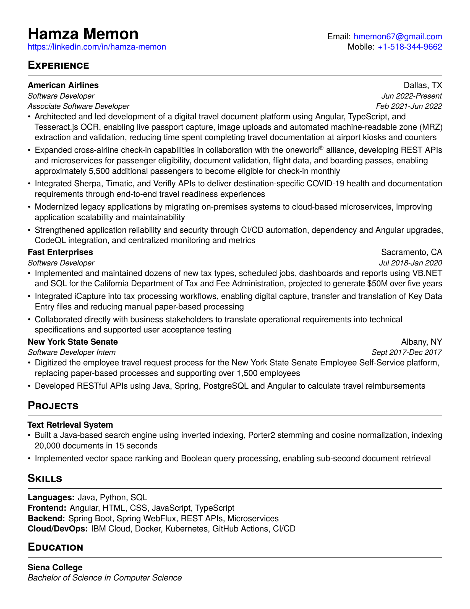

# Hamza Memon's Resume

A single-page resume template for software developers. Built on LaTeX with pre-configured fonts and templates, it provides an easy setup for quick customization. The template features clearly documented sections with consistent formatting across education, experience, and projects.

## Motivation

This LaTeX template was created to improve the resume creation process over Google Drive and Microsoft Word. Formatting in these programs is rather difficult and inefficient to maintain across multiple sections. Using LaTeX allows for much easier customization without having to update styling everywhere whenever you make a change. This allows you to focus on the actual content instead of getting the styling to function.

## Build

```sh
lualatex resume.tex
```

## Preview



## License

The template code is released under the MIT License. All example data belongs to its original author.
